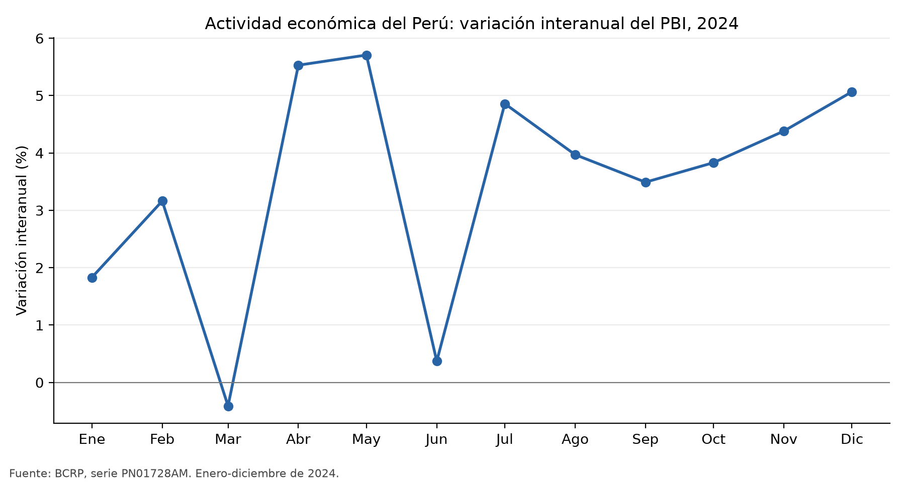
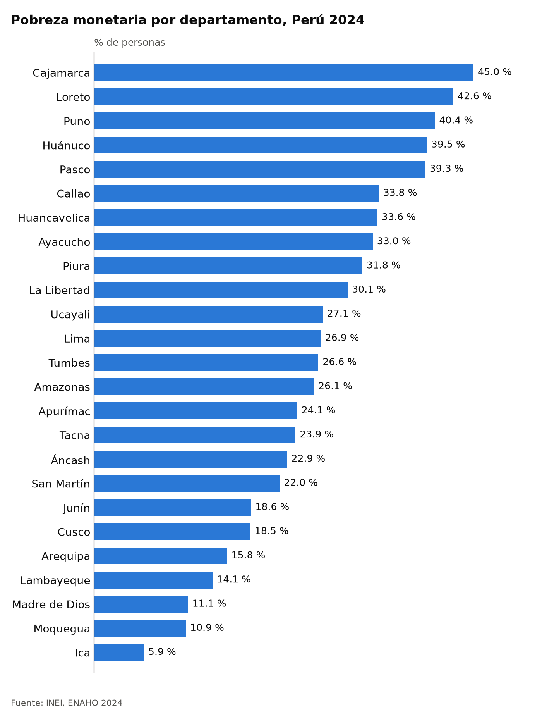
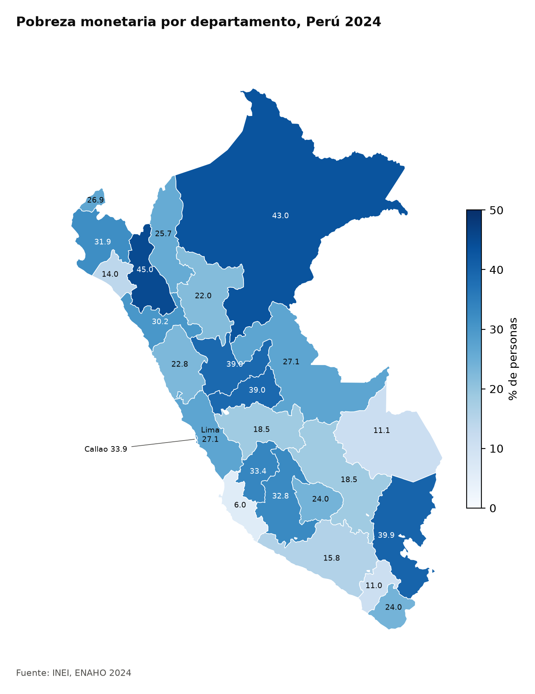

# Informe de investigación socioeconómica: Perú, 2024

## 1. Pregunta de investigación

**Tema:** actividad económica y pobreza monetaria en el Perú.

**Pregunta:** ¿Cómo evolucionó la actividad económica del Perú durante 2024 y
cómo se distribuyó territorialmente la pobreza monetaria entre sus
departamentos en ese mismo año?

**Objetivo:** describir la evolución mensual de la variación interanual del
PBI y caracterizar las diferencias departamentales de pobreza monetaria en
2024, integrando las perspectivas macroeconómica y territorial.

**Delimitación:** actividad económica nacional, observada mensualmente de
enero a diciembre de 2024; pobreza monetaria estimada para 2024 en los 24
departamentos y la Provincia Constitucional del Callao (25 unidades
territoriales). El análisis es descriptivo y no estima efectos causales.

## 2. Fuentes y metodología

### Actividad económica

Se usó la serie mensual BCRP **`PN01728AM`**, “Producto bruto interno y demanda
interna (variación porcentual interanual) - PBI”, consultada mediante el MCP
para enero-diciembre de 2024. Cada observación compara el PBI de un mes con el
del mismo mes del año anterior. El promedio simple de las doce observaciones
se presenta únicamente como resumen descriptivo; no se interpreta como tasa
anual de crecimiento del PBI.

**Fuente original:** [BCRP, serie `PN01728AM`, enero-diciembre de 2024](https://estadisticas.bcrp.gob.pe/estadisticas/series/api/PN01728AM/json/2024-1/2024-12).
La extracción usada en el análisis está en
[`datos/pbi_interanual_mensual_2024.csv`](../datos/pbi_interanual_mensual_2024.csv).

### Pobreza territorial

Se procesaron los microdatos ENAHO 2024 de los módulos 02 (miembros del hogar)
y 34 (sumaria) con [`limpiando-enaho`](../.claude/skills/limpiando-enaho/SKILL.md)
y su script [`limpiar.py`](../.claude/skills/limpiando-enaho/scripts/limpiar.py).
El procesamiento filtró residentes habituales, conservó las llaves como texto,
unió personas y hogares con validación `m:1` y produjo una base de personas
Parquet.

La estimación departamental se calculó como porcentaje de personas pobres,
usando un registro por hogar y el peso `factor07 × mieperho`, conforme a la
Skill [`mapeando-enaho`](../.claude/skills/mapeando-enaho/SKILL.md). Los
indicadores se unieron a las geometrías mediante los códigos territoriales
`ubigeo[:2]` y `FIRST_IDDP`, no por nombres. Lima (15) y Callao (07) se
mantuvieron separados.

Los valores se contrastaron a un decimal con la
[referencia departamental de pobreza ENAHO 2024](../referencias/pobreza_departamento_2024.csv),
preparada para la Sesión 16. La limpieza produjo 108.664 residentes
habituales. Los microdatos no se distribuyen ni versionan en este proyecto.

## 3. Resultados: hallazgos sustentados

1. **El crecimiento interanual del PBI fue irregular.** La variación mensual
   fue de **−0,41 %** en marzo, su mínimo del año; alcanzó **5,71 %** en mayo
   y cerró diciembre en **5,07 %**. El promedio simple de los doce meses fue
   **3,48 %**, calculado por [`parte3_analisis.py`](../scripts/parte3_analisis.py)
   a partir del CSV BCRP. Fuente primaria: serie
   [`PN01728AM`](https://estadisticas.bcrp.gob.pe/estadisticas/series/api/PN01728AM/json/2024-1/2024-12).
2. **La pobreza departamental tuvo una brecha amplia.** Cajamarca presentó
   **45,0 %**, la tasa mayor, frente a **6,0 %** en Ica, la menor: una
   diferencia de **39,0 puntos porcentuales**. Estas cifras provienen de la
   estimación ENAHO ponderada y coinciden con la referencia al redondear a un
   decimal.
3. **Los cinco primeros del ranking se ubicaron en torno o por encima de
   39 % de pobreza.** Cajamarca (45,0 %),
   Loreto (43,0 %), Puno (39,9 %), Pasco (39,0 %) y Huánuco (39,0 %)
   encabezan el ranking procesado. Callao (33,9 %) y Lima (27,1 %) difieren
   y se reportan como unidades territoriales separadas.
4. **La cobertura territorial fue completa.** Se obtuvieron 25 códigos
   únicos; ENAHO, GeoJSON y referencia tuvieron cobertura coincidente, y
   pasaron los 25 cotejos al redondear a un decimal. El detalle está en
   [`validacion_mapa_referencia.txt`](../outputs/parte-3/validacion_mapa_referencia.txt).

## 4. Visualizaciones

### Actividad económica — BCRP



Gráfico de línea elaborado por `scripts/parte3_analisis.py` desde las
observaciones BCRP guardadas en el CSV citado arriba. Unidad: porcentaje de
variación interanual.

### Pobreza por departamento — gráfico ENAHO



Gráfico de barras generado por
[`graficando-enaho`](../.claude/skills/graficando-enaho/SKILL.md) desde la
base ENAHO 2024. Unidad: porcentaje de personas; ponderación con
`facpob07`. La salida se conserva también en
[evidencias de la Skill](../evidencias/parte-2/graficando-enaho/figuras/pobreza_departamento_2024.png).

### Pobreza por departamento — mapa



Mapa de `mapeando-enaho`, con escala secuencial azul y leyenda en porcentaje
de personas. Unión territorial por códigos oficiales, con Lima y Callao
separados.

## 5. Interpretación

La serie del PBI muestra una contracción interanual en marzo, repuntes
posteriores y un cierre de 2024 con crecimiento interanual de 5,07 %. En
paralelo, las estimaciones ENAHO evidencian heterogeneidad territorial
importante: la pobreza estimada en Cajamarca fue 39 puntos porcentuales mayor
que en Ica. El gráfico económico y las visualizaciones territoriales permiten
examinar conjuntamente la coyuntura nacional y la distribución espacial de la
pobreza; no establecen que una haya producido la otra.

## 6. Limitaciones

- **Cobertura temporal:** se analiza un solo año. La serie BCRP tiene 12
  observaciones mensuales interanuales; la pobreza territorial es una
  estimación ENAHO para 2024, no una serie de cambios departamentales a través
  del tiempo.
- **Cobertura geográfica y conceptual:** `PN01728AM` es una medida agregada
  nacional del PBI, mientras que la pobreza se desglosa por departamento. No
  son indicadores de la misma unidad estadística ni se debe inferir una
  relación causal de su coincidencia temporal.
- **Calidad e incertidumbre:** las cifras ENAHO son estimaciones de una
  encuesta. El flujo valida llaves, unión, cobertura, consistencia nacional y
  concordancia con la referencia, pero este informe no calcula errores
  estándar ni intervalos de confianza. Los cotejos departamentales se realizan
  a un decimal; la concordancia no elimina la incertidumbre muestral.
- **Comparabilidad de la fuente:** la serie mensual BCRP puede revisarse en
  publicaciones posteriores. La extracción utilizada se conserva en el CSV y
  se cotejó con el MCP durante este análisis.

## 7. Reproducibilidad y trazabilidad

### Archivos utilizados o generados

- Observaciones BCRP: [`datos/pbi_interanual_mensual_2024.csv`](../datos/pbi_interanual_mensual_2024.csv);
  serie original y consulta: [API BCRP `PN01728AM`](https://estadisticas.bcrp.gob.pe/estadisticas/series/api/PN01728AM/json/2024-1/2024-12).
- Procesamiento ENAHO: [`limpiar.py`](../.claude/skills/limpiando-enaho/scripts/limpiar.py)
  y base generada localmente `salidas/personas_2024.parquet`.
- Mapa y cotejos: [`mapear.py`](../.claude/skills/mapeando-enaho/scripts/mapear.py),
  [CSV de referencia](../referencias/pobreza_departamento_2024.csv) y
  [`validacion_mapa_referencia.txt`](../outputs/parte-3/validacion_mapa_referencia.txt).
- Gráfico ENAHO: [`graficar.py`](../.claude/skills/graficando-enaho/scripts/graficar.py).
- Indicadores, gráfico BCRP, ranking y copia de mapa:
  [`scripts/parte3_analisis.py`](../scripts/parte3_analisis.py),
  [`pobreza_departamental_2024.csv`](../outputs/parte-3/pobreza_departamental_2024.csv),
  [`reproduccion.txt`](../outputs/parte-3/reproduccion.txt).

### Pasos para reproducir

Desde la raíz del proyecto, con Python 3.12 y `uv`. Primero descargar del INEI
los ZIP de los módulos 02 y 34, según los enlaces del [README](../README.md),
y guardarlos en `datos/`. Los microdatos no se versionan.

```bash
uv sync
uv run .claude/skills/limpiando-enaho/scripts/limpiar.py --anio 2024
uv run .claude/skills/graficando-enaho/scripts/graficar.py --por departamento --anio 2024
uv run .claude/skills/mapeando-enaho/scripts/mapear.py --anio 2024
uv run python scripts/parte3_analisis.py
```

La primera Skill genera la base procesada; las siguientes producen el gráfico
ENAHO y el mapa. El script de Parte 3 regenera el gráfico BCRP, el ranking y
la copia del mapa, y vuelve a cotejar los valores departamentales con la
referencia. La consulta BCRP se puede repetir mediante el MCP o la API oficial
indicada arriba.

## 8. Verificación manual de resultados

La tabla documenta cuatro afirmaciones numéricas del informe con datos del
BCRP y ENAHO. Las dos afirmaciones del BCRP se verificaron mediante consultas
al MCP y comparación con el CSV; las dos de ENAHO, comparando los resultados
procesados con el CSV de referencia.

| Afirmación del informe | Valor calculado | Fuente o procedimiento de verificación | ¿Coincide con la referencia? | Diferencia observada | Estado |
|---|---:|---|---|---|---|
| La variación interanual del PBI alcanzó su mínimo en marzo de 2024. | −0,409690120959002 % (−0,41 % en el informe) | Consulta ejecutada con el MCP BCRP `serie`, código `PN01728AM`, para `2024-03`; la imagen aportada muestra `Mar.2024 = -0.409690120959002`; [verificación BCRP marzo de 2024, fecha resaltada](../evidencias/parte-3/verificacion-resultados/bcrp-pbi-marzo-2024.png). Comparado con [`datos/pbi_interanual_mensual_2024.csv`](../datos/pbi_interanual_mensual_2024.csv), fila `2024-03`. | Sí; la consulta MCP, la imagen y el CSV coinciden con el valor mostrado. | 0 con la precisión visible en la imagen; el informe redondea a −0,41 %. | Verificado por la estudiante mediante consulta MCP y comparación con el CSV. |
| La variación interanual del PBI alcanzó su máximo en mayo de 2024. | 5,70691310837814 % (5,71 % en el informe) | Consulta ejecutada con el MCP BCRP `serie`, código `PN01728AM`, para `2024-05`; la imagen aportada muestra `May.2024 = 5.70691310837814`; [verificación BCRP mayo de 2024, fecha resaltada](../evidencias/parte-3/verificacion-resultados/bcrp-pbi-mayo-2024.png). Comparado con [`datos/pbi_interanual_mensual_2024.csv`](../datos/pbi_interanual_mensual_2024.csv), fila `2024-05`. | Sí; la consulta MCP, la imagen y el CSV coinciden con el valor mostrado. | 0 con la precisión visible en la imagen; el informe redondea a 5,71 %. | Verificado por la estudiante mediante consulta MCP y comparación con el CSV. |
| Cajamarca registró la mayor pobreza monetaria departamental. | 45,0069 % (45,0 % en el informe) | Se contrastó el código 06 en el [CSV de referencia](../referencias/pobreza_departamento_2024.csv) con el cálculo en [`pobreza_departamental_2024.csv`](../outputs/parte-3/pobreza_departamental_2024.csv). La estudiante confirmó que coinciden al redondear a un decimal. | Sí: ambos reportan 45,0 % al redondear a un decimal. | 0,0069 puntos porcentuales entre el valor calculado (45,0069 %) y el publicado (45,0 %). | Verificado por la estudiante mediante comparación de los CSV. |
| Ica registró la menor pobreza monetaria departamental. | 6,0142 % (6,0 % en el informe) | Se contrastó el código 11 en el [CSV de referencia](../referencias/pobreza_departamento_2024.csv) con el cálculo en [`pobreza_departamental_2024.csv`](../outputs/parte-3/pobreza_departamental_2024.csv). La estudiante confirmó que coinciden al redondear a un decimal. | Sí: ambos reportan 6,0 % al redondear a un decimal. | 0,0142 puntos porcentuales entre el valor calculado (6,0142 %) y el publicado (6,0 %). | Verificado por la estudiante mediante comparación de los CSV. |
